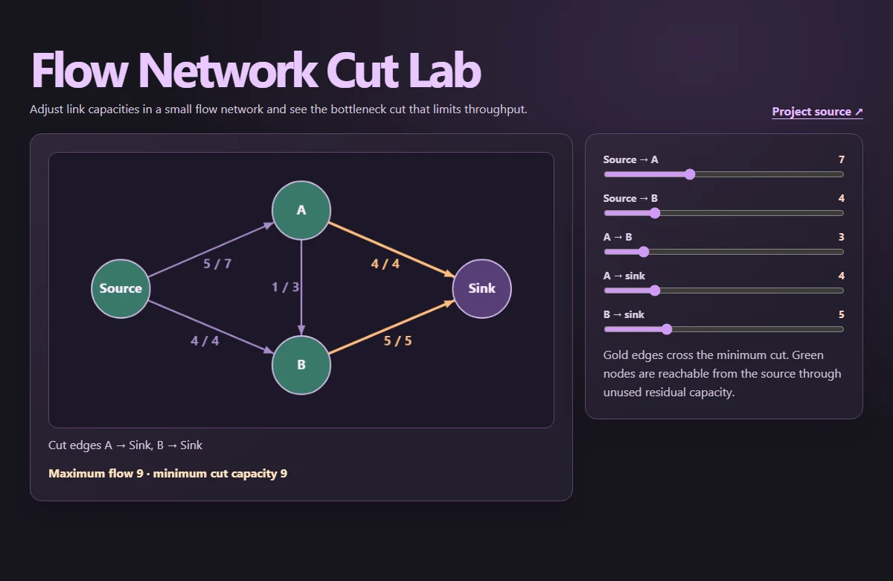

# Flow Network Cut Lab

Adjust link capacities in a small flow network and see the bottleneck cut that limits throughput.

[Open the browser app](https://surfingcoder.com/apps/flow-network-cut-lab/)

## Run locally

Run the following command in this repository and open [localhost:8000](http://localhost:8000).

    python -m http.server 8000

Capacities are integer units per interval. The solver uses breadth-first augmenting paths in the residual network. At termination, reachable vertices form the source side of a minimum cut. A shown cut is one optimal cut and other equally small cuts can exist.

## Verify

Run the following command with Node.js 22 or newer.

    node --test
